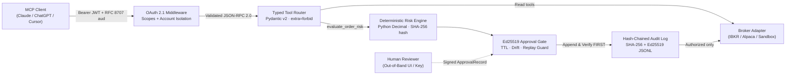

# Fintech MCP Server Blueprint

[](https://github.com/AhmedKhattab1993/fintech-mcp-server/actions/workflows/ci.yml)
[](LICENSE)
[](pyproject.toml)

A production-oriented reference blueprint for **customer-facing financial & trading MCP servers** (Streamable HTTP + stdio JSON-RPC 2.0).

Most MCP demos stop at wrapping three REST endpoints and trusting the system prompt to behave. In real brokerage, trading, and portfolio platforms, the hard 80% lives in the control layer between the model and your execution API:

- **OAuth 2.1 + RFC 9728 Protected Resource Metadata:** Bearer token verification with RFC 8707 audience binding, least-privilege scopes (`portfolio:read`, `market:read`, `orders:propose`, `orders:execute`), and per-user account isolation (IDOR prevention).
- **Strict Pydantic v2 Tool Contracts (`extra="forbid"`):** Rejects hallucinated or prompt-injected fields before business logic ever runs, with explicit token-budget pagination caps.
- **Deterministic `Decimal` Risk & Sizing Engine:** Zero binary floats. The model passes an *intent* (`account_id`, `symbol`, `side`, `quantity`); deterministic Python computes exact notional, buying power, short-sale checks, and post-trade single-name concentration limits, emitting an immutable SHA-256 `proposal_hash`.
- **Non-Bypassable Ed25519 Human Confirmation Gate:** Execution accepts *only* an approved `proposal_hash` signed out-of-band on an operator channel. The MCP server holds only the reviewer's public key and exposes no approval tool—rejecting unapproved calls, forged signatures, failed risk checks, expired TTLs (>15 min), live price drift (>50 bps), and replays.
- **Tamper-Evident Signed Audit Log:** Append-only SHA-256 hash-chained, Ed25519-signed JSONL log written *and verified* before routing any order to the broker adapter.
- **Automated CI Eval Suite:** Runs adversarial security, isolation, arithmetic, and gate regression cases on every push via GitHub Actions.

---

## Architecture



---

## Tool Surface

| Tool | Required OAuth Scope | Behavior |
| :--- | :--- | :--- |
| `get_account_balances` | `portfolio:read` | Exact `Decimal` cash, buying power, and NAV for authorized accounts only |
| `get_positions` | `portfolio:read` | Holdings, market values, and weights with bounded pagination |
| `get_market_quote` | `market:read` | Bid / ask / last quote snapshot |
| `evaluate_order_risk` | `orders:propose` | Computes exact notional & risk checks server-side; returns immutable `proposal_hash` |
| `execute_approved_order` | `orders:execute` | Enforces Ed25519 approval, TTL, drift, replay & audit verification before broker routing |
| `verify_audit_log` | `portfolio:read` | Independently validates full hash chain and Ed25519 signatures |

---

## Quick Start

```bash
uv sync --all-extras

# Run unit & integration test suite
uv run pytest -v

# Run automated security & contract CI evals
uv run python -m evals.run_evals

# Lint
uv run ruff check src tests evals
```

### Run the Streamable HTTP MCP Server locally

```bash
uv run python -c "
import uvicorn
from fintech_mcp.http_app import create_demo_app
app, verifier, _, _ = create_demo_app()
uvicorn.run(app, host='127.0.0.1', port=8080)
"
```

Inspect OAuth 2.1 discovery metadata at `GET http://127.0.0.1:8080/.well-known/oauth-protected-resource` and send authenticated JSON-RPC 2.0 requests to `POST http://127.0.0.1:8080/mcp`.

---

## Repository Structure

```text
src/fintech_mcp/
  auth.py        # OAuth 2.1 bearer verification, RFC 8707 aud, scope & account checks
  schemas.py     # Strict Pydantic v2 tool contracts and response models
  risk.py        # Deterministic Decimal sizing, concentration & pre-trade risk engine
  gate.py        # Out-of-band Ed25519 confirmation gate (TTL, drift, replay guards)
  audit.py       # SHA-256 hash-chained & Ed25519-signed append-only audit log
  broker.py      # BrokerAdapter protocol + deterministic SandboxBrokerAdapter
  router.py      # Transport-agnostic JSON-RPC 2.0 MCP router
  http_app.py    # FastAPI Streamable HTTP transport + RFC 9728 metadata
  server.py      # Stdio JSON-RPC 2.0 MCP transport
tests/
  test_server.py # Unit & HTTP integration tests
evals/
  run_evals.py   # Automated adversarial & contract CI evaluation harness
```

---

## Author & Consulting

Built by **Ahmed Khattab** — AI Agents & MCP Infrastructure Engineer for Finance (Philips, ASML via ICT Group, Valeo; previously led a ~20-tool brokerage MCP server over IBKR, Alpaca, and Binance).

Published as-is under Apache-2.0 as an architectural reference blueprint. For fixed-price production MCP servers, broker/market-data agent integrations, or CI evaluation harnesses, visit **[ahmedkhattab.io](https://ahmedkhattab.io/)** or email `ahmed@ahmedkhattab.io`.

*Engineering reference only. Uses an in-memory sandbox broker adapter and does not connect to live accounts or give investment advice.*
